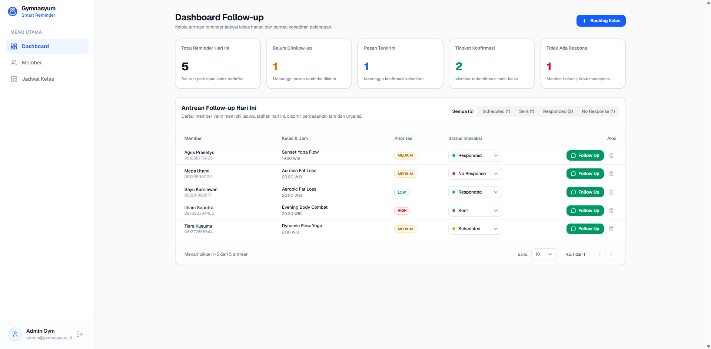
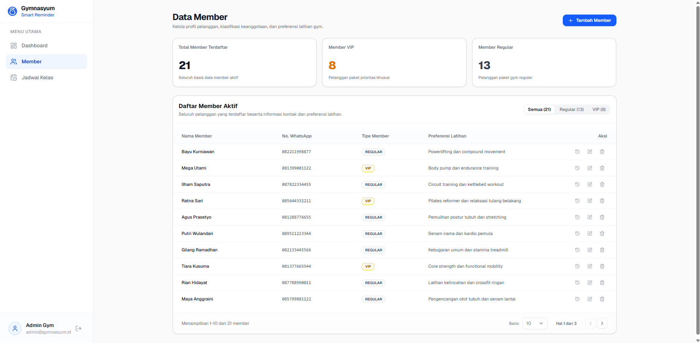
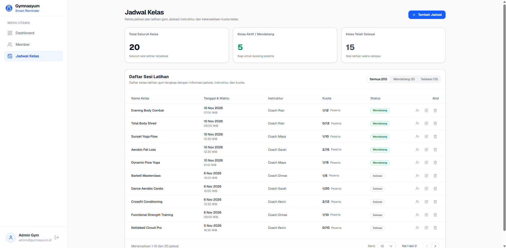
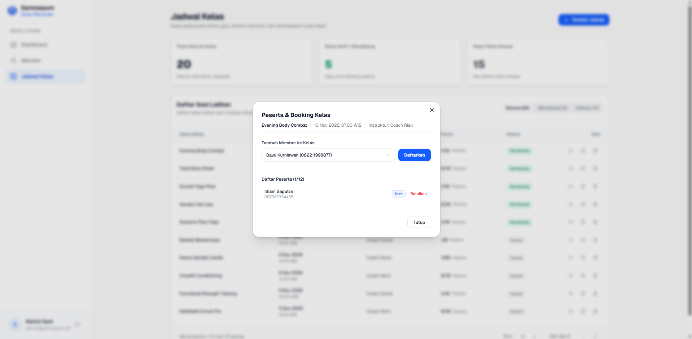
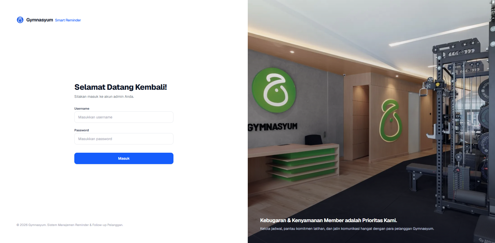

<div align="center">
  
  <h1>Gymnasyum Smart Reminder</h1>
  <p><strong>Sistem Manajemen Reminder &amp; Follow-up Pelanggan Berbasis Web</strong></p>
  <p><em>Dicoding Capstone Project - ID: DB15-I020</em></p>
  <p><strong>Cohort ID: B26B15J007 - Naufal Fahmi Kartika - Full-Stack Web Developer</strong></p>

  <p>
    <strong>Aplikasi Web Live:</strong> <a href="https://gymnasyum.duckdns.org/">https://gymnasyum.duckdns.org/</a> &nbsp;|&nbsp;
    <strong>Swagger API Docs:</strong> <a href="https://gymnasyum.duckdns.org/api-docs">https://gymnasyum.duckdns.org/api-docs</a>
  </p>
</div>

---

## Tangkapan Layar Aplikasi

| Dashboard Follow-up | Manajemen Data Member |
| :---: | :---: |
|  |  |

| Manajemen Jadwal Kelas | Modal Booking Peserta Kelas |
| :---: | :---: |
|  |  |

| Template Pengingat WhatsApp | Halaman Login Admin |
| :---: | :---: |
|  |  |

---

## Tentang Proyek
Gymnasyum Smart Reminder adalah platform berbasis web yang dirancang untuk mempermudah operasional pusat kebugaran (*gym/fitness center*). Sistem ini mengotomasi alur konfirmasi kehadiran member dan pengingat sesi kelas kebugaran melalui integrasi tautan pesan WhatsApp terstruktur, pelacakan kuota peserta secara *real-time*, serta manajemen data member dan jadwal kelas yang terpusat.

### Masalah yang Diselesaikan:
1. **Tingkat Ketidakhadiran Member (*No-Show Rate*)**: Member gym sering kali melewatkan jadwal latihan yang telah dipesan.
2. **Follow-up Manual yang Tidak Efisien**: Staf admin gym menghabiskan banyak waktu menyusun pesan pengingat satu per satu secara manual.
3. **Kelebihan Kapasitas Kelas (*Overbooked*)**: Kuota kelas latihan rawan terlampaui tanpa validasi kapasitas terintegrasi.
4. **Pencatatan yang Terfragmentasi**: Riwayat interaksi dan konfirmasi kehadiran pelanggan sering kali tidak terdokumentasi rapi.

---

## Fitur Utama

### 1. Autentikasi & Otorisasi Admin
- Login berbasis JSON Web Token (JWT).
- Rute halaman terproteksi (*Protected Routes*) di frontend untuk menjaga keamanan data.
- Sesi akun admin dan navigasi keluar (*logout*) terintegrasi pada sidebar.

### 2. Dashboard & Antrean Follow-up
- **Fokus Harian (*Inbox Zero Model*)**: Khusus menampilkan sesi kelas latihan yang berlangsung pada hari ini agar alur kerja admin tetap terorganisir dan efisien.
- **Tab Filter Antrean Terstruktur**:
  - *Perlu Difollow-up* (Default): Menampilkan reminder berstatus `Scheduled` dan `Sent`.
  - *Selesai*: Menampilkan member yang telah direspons (`Responded`) atau tidak ada respons (`No Response`).
  - *Semua*: Rekap menyeluruh seluruh antrean reminder hari ini.
- **Ringkasan Metrik Cepat**: Total Antrean Hari Ini, Belum Difollow-up, Pesan Terkirim, Tingkat Konfirmasi, dan Tidak Ada Respons.
- **Pembuatan Pesan WhatsApp Cerdas**: Integrasi pesan reminder terstruktur otomatis berisi sapaan personal, nama kelas, tanggal, jam pelaksanaan, dan instruktur.
- **Finalisasi Status Berbasis Konfirmasi**: Pembaruan status ke `Responded` atau `No Response` dilengkapi tombol *Submit* konfirmasi sebelum terekam permanen pada riwayat pelanggan.

### 3. Manajemen Data Member
- Operasi CRUD (Create, Read, Update, Delete) data pelanggan.
- Validasi format nomor WhatsApp berbasis numerik.
- Pengelompokan tipe keanggotaan (VIP dan Regular) dengan tab filter cepat.
- Modal riwayat aktivitas pengingat per member lengkap dengan indikator status.

### 4. Manajemen Jadwal Kelas & Booking Peserta
- Operasi CRUD jadwal sesi latihan kebugaran (nama kelas, waktu, instruktur, kuota).
- Filter jadwal berdasarkan waktu pelaksanaan (Semua, Mendatang, Selesai).
- **Indikator Kuota Terisi**: Kolom kuota menampilkan jumlah peserta yang telah terdaftar terhadap kapasitas kelas (misal: `4/15 Peserta`), lengkap dengan badge *Penuh*.
- **Pusat Booking & Daftar Peserta Kelas**:
  - Modal manajemen peserta kelas yang terhubung langsung pada setiap sesi latihan.
  - **Pencarian Member Terintegrasi**: Dropdown pemilihan member dilengkapi kotak pencarian instan (nama atau nomor WhatsApp) langsung di dalam menu dropdown.
  - **Proteksi Kapasitas & Duplikasi**: Pencegahan pendaftaran member ganda pada kelas yang sama (*duplicate booking check*) serta validasi kuota penuh secara *real-time*.
  - **Daftar Peserta Terdaftar**: Menampilkan seluruh member yang terdaftar pada sesi kelas beserta status follow-up dan opsi pembatalan pendaftaran.

### 5. Standar Antarmuka (UI/UX)
- Antarmuka berbasis komponen Shadcn UI dengan tema aksen Royal Blue (`#2563eb`).
- Pencegahan pergeseran tata letak (*anti-layout shift*) menggunakan `table-fixed` dan `scrollbar-gutter: stable`.
- Paginasi data yang konsisten di seluruh tabel.

### 6. Dokumentasi API
- Dokumentasi interaktif berbasis Swagger / OpenAPI 3.0 yang dapat diakses langsung pada endpoint `/api-docs`.

---

## Arsitektur & Teknologi

### Frontend:
- Framework: React 19 (Vite)
- Routing: React Router DOM
- Styling: Tailwind CSS v4
- Ikon: Lucide React
- Desain Komponen: Shadcn UI Pattern
- HTTP Client: Axios (dengan JWT Request Interceptor)

### Backend:
- Runtime & Framework: Node.js & Express.js
- Database: PostgreSQL (Driver `pg` dengan Connection Pool)
- Validasi Request: Joi Schema
- Keamanan: JWT (`jsonwebtoken`), CORS, Dotenv
- Dokumentasi: Swagger JSDoc & Swagger UI Express

---

## Skema Database

Sistem menggunakan database relasional PostgreSQL dengan tiga tabel utama:

```
[ customers ] 1 ──< [ reminders ] >── 1 [ schedules ]
```

1. **customers**: Menyimpan biodata pelanggan gym (`id`, `name`, `whatsapp_number`, `member_type`, `preferences`, `created_at`).
2. **schedules**: Menyimpan sesi kelas latihan (`id`, `class_name`, `class_time`, `instructor_name`, `quota`, `created_at`).
3. **reminders**: Menghubungkan member dan jadwal sesi latihan (`id`, `customer_id`, `schedule_id`, `priority`, `status`, `created_at`, `updated_at`). Menggunakan *foreign key cascade delete*.

---

## Panduan Instalasi Lokal

### 1. Prasyarat Sistem
- Node.js versi 18.x atau lebih baru
- PostgreSQL Server aktif
- Git

---

### 2. Konfigurasi Backend & Database
1. Buka terminal dan masuk ke direktori backend:
   ```bash
   cd backend
   ```

2. Pasang dependensi:
   ```bash
   npm install
   ```

3. Buat database baru di PostgreSQL:
   ```sql
   CREATE DATABASE gymnasyum_db;
   ```

4. Buat file `.env` pada direktori `backend/` dengan konfigurasi berikut:
   ```env
   PORT=5000
   DB_USER=postgres
   DB_PASSWORD=password_database_anda
   DB_HOST=localhost
   DB_PORT=5432
   DB_NAME=gymnasyum_db

   ADMIN_USERNAME=admin
   ADMIN_PASSWORD=admin123
   JWT_SECRET=super_secret_jwt_key_gymnasyum
   ```

5. Jalankan inisialisasi tabel:
   ```bash
   npm run db:init
   ```

6. Jalankan seeder data dummy (21 member, 21 jadwal, 21 antrean reminder):
   ```bash
   npm run db:seed
   ```

7. Jalankan server pengembang backend:
   ```bash
   npm run dev
   ```
   *Backend berjalan pada `http://localhost:5000` dan Swagger API pada `http://localhost:5000/api-docs`.*

---

### 3. Konfigurasi Frontend
1. Buka terminal baru dan masuk ke direktori frontend:
   ```bash
   cd frontend
   ```

2. Pasang dependensi:
   ```bash
   npm install
   ```

3. Jalankan server pengembang frontend:
   ```bash
   npm run dev
   ```
   *Frontend dapat diakses pada `http://localhost:5173`.*

---

## Kredensial Administrator
- **Username**: `admin`
- **Password**: `admin123`

---

## Daftar Endpoint API

| Method | Endpoint | Deskripsi | Akses |
| :--- | :--- | :--- | :---: |
| POST | `/api/v1/auth/login` | Autentikasi admin dan penerbitan token JWT | Publik |
| GET | `/api/v1/customers` | Mengambil seluruh data member | Terproteksi |
| POST | `/api/v1/customers` | Mendaftarkan member baru | Terproteksi |
| PUT | `/api/v1/customers/:id` | Memperbarui data member | Terproteksi |
| DELETE | `/api/v1/customers/:id` | Menghapus data member | Terproteksi |
| GET | `/api/v1/schedules` | Mengambil seluruh jadwal kelas | Terproteksi |
| POST | `/api/v1/schedules` | Menambahkan jadwal kelas baru | Terproteksi |
| PUT | `/api/v1/schedules/:id` | Memperbarui data jadwal kelas | Terproteksi |
| DELETE | `/api/v1/schedules/:id` | Menghapus data jadwal kelas | Terproteksi |
| GET | `/api/v1/reminders` | Mengambil seluruh antrean reminder | Terproteksi |
| POST | `/api/v1/reminders` | Pendaftaran member ke jadwal kelas | Terproteksi |
| PATCH | `/api/v1/reminders/:id/status` | Memperbarui status interaksi reminder | Terproteksi |
| DELETE | `/api/v1/reminders/:id` | Menghapus reminder dari antrean | Terproteksi |
| GET | `/api/v1/reminders/customer/:id` | Riwayat reminder spesifik member | Terproteksi |

---

## Deployment (AWS)
Aplikasi telah berhasil di-deploy dan aktif berjalan secara publik di infrastruktur Amazon Web Services (AWS) dengan domain kustom dan sertifikat SSL:
- **Tautan Website Live**: [https://gymnasyum.duckdns.org/](https://gymnasyum.duckdns.org/) (IP: `13.214.36.68`)
- **Dokumentasi API (Swagger)**: [https://gymnasyum.duckdns.org/api-docs](https://gymnasyum.duckdns.org/api-docs)
- **Kredensial Admin Default**: `admin` / `admin123`
- **Domain & Protokol Keamanan**: DuckDNS dengan sertifikat SSL/TLS HTTPS otomatis via Let's Encrypt (Certbot).
- **Server Komputasi**: AWS EC2 (Ubuntu Server 24.04 LTS) di Region Singapore (`ap-southeast-1`).
- **Process Manager**: PM2 untuk menjaga proses backend Node.js aktif 24/7.
- **Web Server & Reverse Proxy**: Nginx untuk melayani aset frontend React dan meneruskan request API `/api/` ke backend.
- **Basis Data**: PostgreSQL Server aktif pada instance EC2.
- **Keamanan Jaringan**: AWS Security Group dengan port 80 (HTTP), 443 (HTTPS), dan port 22 (SSH).

---

## Lisensi
MIT License
